 
<h4>嗨，我是Mag！

 </h4>

<b>Honors Maths/CS → NYU</b>

<b>About Me</b>

&nbsp;&nbsp;&nbsp;&nbsp; I'm studying Maths/CS at NYU, graduating May 2028. I work mostly in C++ and, besides systems programming, enjoy competitive programming. Projects I have built / am building: lock-free data structures, multiple order books and a matching engine, a physics engine, and a Memory profiler for Apple Silicon

 

**[fill-or-kill](https://github.com/magnuls/fill-or-kill)** · pro-rata limit order book matching engine in C++

**[lockfree-structures](https://github.com/magnuls/lockfree-structures)** · lock-free DS: SPSC ring buffer, Treiber stack, hazard pointers, MPMC queues

**[Cache-Performance](https://github.com/magnuls/Cache-Performance)** · A latency profile for memory hierarchy on Apple Silicon

**[Physics-Engine-Mag](https://github.com/magnuls/Physics-Engine-Mag)** · 3D physics engine in C++

**[csv_cleaner_cli_tool](https://github.com/magnuls/csv_cleaner_cli_tool)** · CL csv cleaning tool

**[web_cam_gui](https://github.com/magnuls/web_cam_gui)** · webcam GUI

**[Nvim-Setup](https://github.com/magnuls/Nvim-Setup)** · my nvim config

