**[lob-latency-research](https://github.com/magnuls/fill-or-kill)** · pro-rata limit order book matching engine in C++

**[lockfree-structures](https://github.com/magnuls/lockfree-structures)** · lock-free DS: SPSC ring buffer, Treiber stack, hazard pointers, MPMC queues

**[Cache-Performance](https://github.com/magnuls/Cache-Performance)** · A latency profile for memory hierarchy on Apple Silicon

**[Physics-Engine-Mag](https://github.com/magnuls/Physics-Engine-Mag)** · 3D physics engine in C++

**[csv_cleaner_cli_tool](https://github.com/magnuls/csv_cleaner_cli_tool)** · CL csv cleaning tool

**[web_cam_gui](https://github.com/magnuls/web_cam_gui)** · webcam GUI

**[Nvim-Setup](https://github.com/magnuls/Nvim-Setup)** · my nvim config

