<h3>hi ! </h1>

  

<h1 align="center">MJP</h1>

  <code>&gt; c++ · systems-programming · concurrency ·micro-architecture</code>

  
  

  
  &nbsp;
  

---

### `> currently building`

- **[lockfree-structures](https://github.com/magnuls/lockfree-structures)** — lock-free data structures in C++: SPSC ring buffer, Treiber stack, hazard pointers, MPMC queues
- **[fill-or-kill](https://github.com/magnuls/fill-or-kill)** — pro-rata limit order book matching engine
- **order book benchmark** — benchmarking order book data structures for latency
- **CPU cache benchmark** — measuring cache and memory hierarchy behavior
